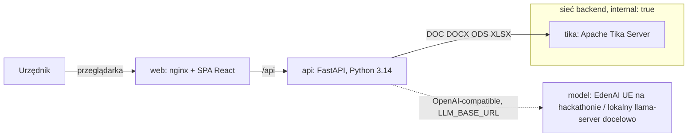
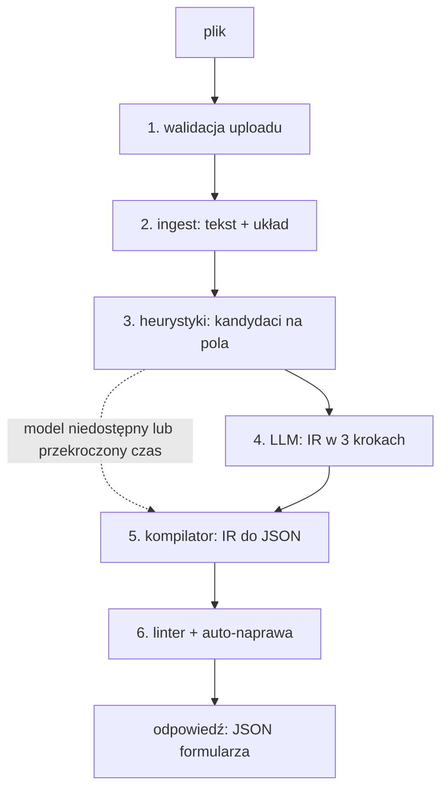

# Architektura: Kompilator Formularzy

Stan: projekt przed implementacją (2026-11-21). Nazwa robocza, pakiet Pythona `formcompiler`.
Źródła decyzji: raporty w [`research/`](research/), materiały organizatora w `Docs/`.

## 1. Teza

Zadanie nie polega na przepisaniu blankietu. Wynik ma wyglądać jak formularz zaprojektowany przez analityka COI: strony tematyczne, sekcje predefiniowane („Twoje dane”, „Adres”, „Podmiot wniosku”), słowniki, dane z rejestrów, warunki widoczności.

Dlatego budujemy **kompilator, a nie OCR**:

1. Parser wyciąga z pliku tekst z układem.
2. Reguły i lokalny model LLM **rozumieją** blankiet i zwracają krótką reprezentację pośrednią (IR).
3. Kod deterministyczny **składa** końcowy JSON z biblioteki sekcji predefiniowanych.
4. Linter sprawdza wszystkie reguły techniczne i naprawia naruszenia.

Model nigdy nie pisze końcowego JSON-a. Dzięki temu plik zawsze przechodzi reguły techniczne, a czas odpowiedzi mieści się w minutach na laptopie bez karty graficznej.

## 2. Rozważone podejścia

| Podejście | Zalety | Wady | Decyzja |
|---|---|---|---|
| A. Model generuje cały JSON jednym wywołaniem | najmniej kodu | ok. 15 tys. tokenów wyjścia, czyli ponad 16 min na M4; model myli identyfikatory i odwołania w JSONata | odrzucone |
| B. Same reguły i szablony, bez modelu | szybkie, powtarzalne, zawsze poprawne | słabe na nietypowych blankietach, nie upraszcza języka | zostaje jako tryb awaryjny |
| C. Reguły + IR z modelu + kompilator + linter | poprawność z kodu, rozumienie z modelu, awaria modelu nie psuje wyniku | więcej modułów | **wybrane** |
| D. Model wizyjny czyta obrazy stron | radzi sobie ze zdjęciami | drugi duży model nie mieści się w 16 GB obok LLM, wolne | poza MVP, opcja konfiguracyjna |

## 3. Wymagania twarde i sposób ich spełnienia

| Wymaganie organizatora | Realizacja |
|---|---|
| Python 3.14+ lub Java 21+ | API w Pythonie 3.14; sidecar Apache Tika na Javie 25 tylko do plików biurowych |
| Tylko open source bez copyleft | lista dozwolonych zależności w `CLAUDE.md`, bramka licencyjna w CI |
| Brak zewnętrznych API, SaaS, MCP; brak modeli dostępnych tylko przez API | model open-weight (Apache-2.0) za `LLM_BASE_URL`; na hackathonie przez EdenAI (świadomy wyjątek, D11), docelowo lokalny `llama-server`; tryb reguł działa bez sieci |
| REST API przyjmujące jeden plik | `POST /api/v1/forms` |
| Formaty PDF, DOC, DOCX, ODS, XLSX, JPG, JPEG, PNG | patrz sekcja 5.1 |
| Weryfikacja MIME, nazwy i rozmiaru pliku | patrz sekcja 9 |
| Plik tylko w RAM lub w przestrzeni tymczasowej żądania | brak bazy i brak zapisu na dysk; `/tmp` to `tmpfs` |
| Docker: oficjalne obrazy, lekkie dystrybucje, przypięte wersje, non-root, minimum portów, sekrety w runtime | patrz sekcja 10 |
| Konfiguracja: rozmiar pliku, JWT, parametry integracyjne | zmienne środowiskowe, sekcja 8.3 |
| README: budowanie, uruchomienie, konfiguracja, REST API | `README.md` uzupełniany razem z kodem |

## 4. Widok ogólny



Publikowany jest tylko port `web` (8080). `tika` nie ma wyjścia do internetu. `api` jest w sieci `backend` i w sieci z wyjściem na zewnątrz, z którego korzysta wyłącznie do `LLM_BASE_URL`; przy `LLM_ENABLED=false` może działać z `--network none`.

## 5. Potok przetwarzania



### 5.1 Ingest

Każdy format trafia do jednego modelu `Document`: lista stron, na każdej linie tekstu z identyfikatorem (`L17`), współrzędnymi i znacznikami układu. Identyfikatory linii służą później do pokazania w interfejsie, skąd wzięło się pole.

| Wejście | Narzędzie | Uwagi |
|---|---|---|
| PDF z warstwą tekstową | `pdfplumber` (tekst, linie, prostokąty), `pypdfium2` (render strony) | pola wyboru to często grafika wektorowa albo glif Wingdings; wykrywamy je z prostokątów i nazwy fontu, bo sam tekst ich nie zawiera |
| PDF bez warstwy tekstowej, JPG, JPEG, PNG | cięcie na strony, prostowanie, potem RapidOCR (`rapidocr` + `onnxruntime`, modele PP-OCRv6 small) z `use_cls=false` | zmierzone na M4: CER 1,2–4,2%, 1,0–1,8 s na stronę; z domyślnym klasyfikatorem orientacji CER rośnie do 16% |
| DOC, DOCX, ODS, XLSX | Apache Tika Server 3.3.2, wynik XHTML | jeden adapter dla czterech formatów; tabele zachowane. Klient musi wysłać `Content-Type` pliku (albo `application/octet-stream`): bez niego, np. z `urllib`, Tika wybiera `EmptyParser` i zwraca pusty tekst (sprawdzone); `httpx` z `content=` działa poprawnie |

Zasada: **warstwa natywna zawsze, OCR tylko dla rastra.** Parser natywny działa w milisekundach, nie myli znaków i zachowuje kratki, wykropkowania i tabele. OCR gubi wszystkie wykropkowania i 62–100% kratek, więc dla rastrów heurystyki opierają się na samym tekście (etykieta z dwukropkiem, lista krótkich pozycji), a resztę rozstrzyga model.

Pułapki zmierzone na próbkach:

- Tika zamienia kratki zrobione jako punktory listy (`numbering.xml`) na znak `·`. Krótka lista punktowana jest więc kandydatem na opcje wyboru.
- W PDF kratki to glify fontów symbolicznych (Wingdings U+F0F0, U+F071, U+2751, U+25A1) albo prostokąty wektorowe. Wykrywamy je po nazwie fontu i geometrii.
- Żaden z dziewięciu przykładowych PDF nie ma pól AcroForm.

Bardzo wysokie obrazy (próbki mają do 1654×37 424 px, wysokość to wielokrotność 2339 px, czyli A4 przy 200 DPI) tniemy na strony przed OCR. Bez cięcia RapidOCR daje CER 99,9%, a Tesseract odrzuca plik. Gdy wysokość nie jest wielokrotnością strony, tniemy w najszerszym poziomym pasie bez tuszu w zakresie ±15% wysokości strony, a gdy takiego pasa nie ma (zdjęcie), tniemy z zakładką i usuwamy zduplikowane linie.

Po ingest dokument jest linearyzowany do tekstu z prostymi znacznikami: `[ ]` pole wyboru, `____` miejsce do wpisania, `|` komórki tabeli, `#` nagłówek, `--- strona N ---`.

### 5.2 Heurystyki (tryb „reguły najpierw”)

Deterministyczne wykrywanie kandydatów na pola. Działa bez modelu i jest jednocześnie ścieżką awaryjną.

- etykieta przed kropkami lub podpis pod linią (`/ PESEL /`) → pole tekstowe,
- lista pól wyboru → `RADIO` (wykluczające się) albo `CHECKBOX`; powyżej 5 opcji `SELECT`, powyżej 15 z wyszukiwarką,
- słowa kluczowe → walidatory i typy: PESEL, NIP, REGON, e-mail, kod pocztowy, ePUAP, e-Doręczenia, seria i numer dowodu, „data” → `DATEPICKER`, „załącznik”, „dołącz” → `FILE_UPLOADER`,
- kilka pustych linii pod pytaniem → `TEXTAREA`,
- „oświadczam”, „wyrażam zgodę” → `CONSENT_SECTION`,
- „podpis”, „miejscowość, dnia”, „pieczęć”, „wypełnia organ” → pomijane (formularz elektroniczny tego nie zbiera),
- pouczenia i informacje → `TEXT_BLOCK` albo opis sekcji,
- dane osobowe i adresowe wnioskodawcy → oznaczone jako pokryte przez sekcje predefiniowane.

### 5.3 LLM: trzy krótkie wywołania

Wejście modelu to zlinearyzowany tekst i lista kandydatów z heurystyk. Wyjście to IR, po jednej krótkiej pozycji na pole.

| Krok | Zadanie modelu | Wyjście |
|---|---|---|
| A. Inwentarz | potwierdzić lub poprawić kandydatów, nadać etykiety prostym językiem, typ, wymagalność, walidatory, opcje; ustalić tytuł, adresata i kto może złożyć wniosek | płaska lista pól |
| B. Struktura | przypisać pola do sekcji predefiniowanych albo nowych sekcji tematycznych, ułożyć strony, wskazać sekcje powtarzalne | drzewo strony → sekcje → klucze pól |
| C. Zależności | wskazać warunki widoczności między polami i sekcjami, zaproponować słowniki | lista trójek warunków, lista słowników |

Zasady:

- schematy odpowiedzi są płaskie, z enumami, bez `$ref`; wymuszamy je przez `response_format: json_schema` w `llama-server`,
- `temperature` 0, stałe ziarno, jawny `max_tokens` i limit czasu na krok,
- statyczny początek promptu (instrukcje, standardy COI, przykłady) jest identyczny między wywołaniami, żeby zadziałał cache promptu,
- długie formularze dzielimy na bloki stron w kroku A,
- przykłady few-shot powstają z dwóch referencyjnych JSON-ów zdekompilowanych do IR,
- błąd, limit czasu albo niepoprawna odpowiedź w dowolnym kroku: jedno ponowienie, potem wynik z heurystyk. Odpowiedź API zawsze jest poprawnym formularzem.

### 5.4 Reprezentacja pośrednia (IR)

```text
FormIR
  title            tytuł zaczynający się od Wniosek / Zgłoszenie / Deklaracja / Oświadczenie
  addressee        nazwa urzędu lub organu + rodzaj (URZAD | ORGAN)
  applicant        persons: bool, entities: bool, proxy: bool
  pages[]          title, sections[]
SectionIR
  ref              identyfikator szablonu z biblioteki albo brak (sekcja własna)
  title, description, repeating: bool, show_if: Cond?
  fields[]
FieldIR
  key              slug, z niego powstaje techName
  label, description, type (11 typów komponentów)
  required, validators[], options[], dictionary?, initial? (np. MLPZ.email)
  show_if: Cond?, read_only_if: Cond?
  src[]            identyfikatory linii źródłowych
  confidence       0..1
Cond
  all | any        lista warunków prostych
  prosty warunek   field: key, op: IN | NOT_IN, value
```

IR jest modelem Pydantic. Ten sam model waliduje odpowiedź LLM i jest wejściem kompilatora.

### 5.5 Biblioteka sekcji predefiniowanych

Szablony odtwarzają sekcje ze „Standardów i dobrych praktyk” oraz z dwóch referencyjnych JSON-ów: adresat (urząd albo organ), „Podmiot wniosku”, „Twoje dane”, adres (zamieszkania, zameldowania, siedziby, korespondencyjny), „Dane innej osoby” z adresem, „Dane podmiotu” z adresem siedziby, potwierdzenie reprezentanta, „Pełnomocnictwo”, „Opłata skarbowa” w dwóch wersjach, „Dane do kontaktu”, zgody i oświadczenia, podsumowanie, podgląd.

Każdy szablon niesie gotowe pola, walidatory, słowniki (`Kraje`, TERYT), dane inicjalne (`MLPZ.*`, `PESEL.*`) i warunki `SHOW`. Flagi `applicant` z IR decydują, które sekcje i opcje się pojawią. To daje większość z ok. 30 warunków `SHOW` z referencji bez udziału modelu.

Układ stron jest stały:

1. „Dane”: adresat, podmiot wniosku, dane i adresy stron, pełnomocnictwo, opłata skarbowa.
2. Jedna lub więcej stron przedmiotu wniosku (ustala model).
3. „Kontakt i zgody”: dane do kontaktu, załączniki ogólne, oświadczenia.
4. Strona końcowa (`FINISH`): podsumowanie i podgląd, bez pól wejściowych.

### 5.6 Kompilator: kontrakt wyjścia

Ustalenia z referencyjnych JSON-ów (to one są wzorcem importu, nie plik schematu):

| Element | Reguła |
|---|---|
| Korzeń | `title`, `tabs[]`, `flow.links[]` |
| Strona | `id` (UUID), `title`, `type` (`MAIN` albo `FINISH`), `questions[]` |
| Sekcja | wpis w `questions`: `x: 0`, `cols: 3`, `y` narastająco, `rows` = liczba pól + 1; `field.type` = `SECTION` albo `REPEATING_SECTION` |
| Pola sekcji | w `field.repeatingSectionGrid[]` (w referencjach tak, w pliku schematu literówka `repetingSectionGrid`); `x: 0`, `cols: 3`, `rows: 1`, `y` = kolejność |
| Każde pole | `id`, `type`, `techName`, `title`, `description`, `options`, `validation`, `readOnly`, `repeatingSectionGrid`, `states`, `questionOrder`, `tooltipMessage` |
| `techName` | slug ASCII z podkreślnikami, unikalny w całym formularzu |
| `description` | HTML: `<html><head></head><body><p>…</p></body></html>` |
| Opcje | `id` = `name` = tekst opcji, `techName` = slug |
| `SELECT` | dodatkowo `dictionaryName`, `multiLevelTree`, `searchEnabled`, `defaultValue` jako lista |
| Dane inicjalne | `defaultValue: "MLPZ.name"`, `defaultValueType: "EXTERNAL_SYSTEM"`; dane z rejestru PESEL zawsze `readOnly: true` |
| Sekcja zgód | `consentSectionConfig.consents[]` z `description` (HTML) i `required`, oraz `files[]` |
| Warunek | `states: [{type: "SHOW", query}]`, zapytanie według szablonu poniżej |
| Przepływ | `flow.links[]`: `id`, `source`, `target`; łańcuch przez wszystkie strony po kolei |
| Identyfikatory | UUID wersji 5 liczony z `techName`, więc ten sam plik daje ten sam JSON |

Szablon JSONata, składany wyłącznie przez kod:

```text
("<wartość>" in tabs['<tytuł strony>' in title].questions['<techName sekcji>' in field.techName].field.repeatingSectionGrid['<techName pola>' in field.techName].field.__userAnswer)
```

Negacja to `$not(...)`, łączenie przez `and` i `or`. Tytuły stron muszą być unikalne, bo warunek odwołuje się do strony przez tytuł.

Walidatory zapisujemy jako listę nazw, np. `["REQUIRED", "PESEL"]`. Potwierdza to `OpisImportowanegoPlikuJSON`: „tablica stringów przyjmująca nazwy predefiniowanych walidacji”. W referencji 1 kilka pól ma `validation: {}`; to błąd tego pliku, a kompilator zawsze zapisuje listę.

Niespójności referencji, które pomija test odwracalności (`api/tests/test_roundtrip.py`): ręcznie dobrane `rows` sekcji i identyfikatory, białe znaki w zapytaniach JSONata, różne `multiLevelTree` i `searchEnabled` przy identycznych polach `SELECT`, brak `techName` jednej opcji, `minItemRows` przy jednej sekcji. Opisy z bogatym HTML-em (style, linki, obrazy) przechodzą przez IR dosłownie w `description_html`.

### 5.7 Linter i auto-naprawa

Reguły pochodzą z „Reguł technicznych konfiguracji formularzy”. Każda ma kod, komunikat i, gdzie to możliwe, naprawę.

- tytuł niepusty, najwyżej 255 znaków,
- co najmniej dwie strony; dokładnie jedna `FINISH` i jest ostatnia; pozostałe `MAIN`,
- każda strona ma co najmniej jedno pole,
- każde pole leży w sekcji albo sekcji powtarzalnej; brak sekcji w sekcji,
- strona `FINISH` nie zawiera pól wejściowych,
- typ komponentu z listy 11 dozwolonych; walidator z listy 9 dozwolonych i pasujący do typu pola,
- słownik tylko w `SELECT`, `RADIO`, `CHECKBOX`; przy słowniku pusta lista opcji,
- pole zasilane z rejestru jest `readOnly` i ma jedno źródło z listy atrybutów (`PESEL`, `PESEL_ADDRESS`, `MLPZ`),
- unikalne `id` i `techName`,
- każde zapytanie JSONata się parsuje i wskazuje istniejącą stronę, sekcję i pole oraz istniejącą wartość opcji,
- `flow.links` łączy wszystkie strony w jedną ścieżkę do `FINISH`,
- zgodność ze schematem JSON organizatora.

Kody reguł: błędy `L001`–`L025`, ostrzeżenia `L101`–`L111` (tabela w docstringu `api/src/formcompiler/lint.py`).

Druga grupa to ostrzeżenia jakościowe ze standardów COI (nie blokują): etykiety prostym językiem (słowa powyżej 4 sylab, formy bezosobowe, „dokonać”, „posiadać”, imiesłowy na „-ąc”), zgody tylko w sekcji zgód, lista powyżej 15 opcji ma wyszukiwarkę.

## 6. Model LLM i runtime

| Element | Wybór | Zapas |
|---|---|---|
| Model | `Qwen/Qwen3.5-9B`, Apache-2.0, open-weight; na hackathonie `flexai/Qwen3.5-9B@eu` przez EdenAI; lokalnie tryb rozumowania wyłączony w szablonie czatu `llama-server` | `Ministral-3-8B-Instruct-2512` (Apache-2.0); Bielik i PLLuM jako modele do podmiany, nietestowane |
| Serwer | hackathon: EdenAI (endpoint UE); docelowo `llama-server` (llama.cpp, MIT) z GGUF Q4_K_M, ok. 5,5 GB | Ollama |
| Klient | `httpx` + modele Pydantic | — |

Model jest wymienny przez `LLM_BASE_URL` i `LLM_MODEL`. Kod nie zawiera nic specyficznego dla EdenAI.

Profile uruchomienia:

- **domyślny** (`docker compose up` bez `.env`): `web`, `api`, `tika`, tryb reguł, bez sieci zewnętrznej (D14),
- **hackathon i obrona**: to samo plus `.env` z `LLM_BASE_URL` EdenAI, `LLM_ALLOW_REMOTE=true` i kluczem w runtime,
- **produkcja (opis w README, nietestowana na hackathonie)**: lokalny `llama-server` z tym samym modelem w GGUF, na CPU albo na karcie 16 GB; zmiana wyłącznie w `LLM_BASE_URL`.

Wszystkie liczby tok/s w raportach to szacunki. W trakcie developmentu nie uruchamiamy modeli self-hostowanych (decyzja D11): jakość mierzymy na tych samych wagach open-weight wołanych przez EdenAI, a czas odpowiedzi szacujemy z rozmiaru modelu. W czasie hackathonu modelu nie hostujemy lokalnie ani razu (D21); hostowanie lokalne opisuje README.

## 7. Słowniki, dane inicjalne, nowe słowniki

- Dopasowanie pól do słowników (`Kraje`, TERYT, numery kierunkowe) i do atrybutów rejestrów robi kod na podstawie sekcji predefiniowanej i słów kluczowych; model może tylko wskazać kandydata z enuma.
- Nowy słownik proponujemy, gdy lista ma wiele opcji albo powtarza się między formularzami (np. dyscypliny sportowe, rodzaj nieruchomości). Propozycja zawiera nazwę, strukturę, pozycje i listę pól, które by go używały.
- Propozycja trafia do raportu, a w JSON-ie formularza pole zachowuje opcje wpisane wprost. Dzięki temu plik importuje się także bez nowego słownika.

## 8. API

### 8.1 Endpointy

| Metoda i ścieżka | Opis |
|---|---|
| `POST /api/v1/forms` | `multipart/form-data`, pole `file`. Odpowiedź 200: czysty JSON konfiguracji formularza, gotowy do importu |
| `POST /api/v1/forms?details=true` | odpowiedź `{form, report}`; `report` zawiera pochodzenie pól (linie i ramki), pewność, wynik lintera, propozycje słowników, czasy etapów, nazwę modelu i tryb (LLM albo reguły) |
| `GET /health` | stan usługi i dostępność modelu, bez tokenu |
| `GET /docs` | OpenAPI |

Kontrakt `?details=true` (ustalony 17:45 dla frontendu; pola mogą dochodzić, istniejące się nie zmieniają):

```json
{
  "form": { "title": "…", "tabs": [], "flow": { "links": [] } },
  "report": {
    "mode": "llm",
    "model": "flexai/Qwen3.5-9B@eu",
    "timings_ms": { "ingest": 120, "heuristics": 4, "llm": 9100, "compile": 3, "lint": 2 },
    "lint": [
      { "code": "L005", "severity": "error", "message": "Pole leży poza sekcją", "path": "tabs[1].questions[0]", "fixed": true }
    ],
    "fields": [ { "techName": "imie", "src": ["L12"], "confidence": 0.9 } ],
    "document": {
      "pages": [ { "number": 1, "lines": [ { "id": "L1", "text": "WNIOSEK", "kind": "HEADING" } ] } ]
    },
    "dictionary_proposals": []
  }
}
```

`mode` to `llm` albo `rules`; `severity` to `error` albo `warning`; `kind` linii to `TEXT`, `HEADING`, `CHECKBOX` albo `TABLE_ROW` (model `Document`).

`dictionary_proposals` (rozszerzenie II, `dictionaries.py`) liczy kod bez modelu, na gotowym formularzu po linterze. Propozycją jest pole `SELECT`, `RADIO` albo `CHECKBOX` z opcjami wpisanymi w pole (bez słownika), które ma co najmniej 3 różne opcje, każdą najwyżej 6-wyrazową (nazwy, nie zdania), nie jest pytaniem tak/nie, nie należy do sekcji predefiniowanych COI i nie pokrywa go istniejący słownik (Kraje, Województwo, Powiat, Gmina, Miejscowość, Numery kierunkowe; rozpoznawane po etykiecie, a województwa i „Polska” także po opcjach). Pola z identyczną listą opcji łączymy w jedną propozycję (`fields` to ich `techName`). `name` to etykieta pola bez nawiasów i końcowej interpunkcji, a gdy etykieta jest poleceniem („Wybierz…”, „Proszę…”), tytuł sekcji. `items` zachowują kolejność z formularza. Sam formularz się nie zmienia: pola zostają z opcjami wpisanymi w pole.

Przetwarzanie jest synchroniczne i bezstanowe. Tryb wsadowy realizuje frontend, wysyłając pliki po kolei.

### 8.2 Błędy

Format `application/problem+json`. Kody: 400 zła nazwa pliku, 401 brak lub zły token, 413 za duży plik, 415 nieobsługiwany typ albo treść niezgodna z rozszerzeniem, 422 dokument nieczytelny, 504 przekroczony limit czasu.

### 8.3 Konfiguracja (zmienne środowiskowe)

| Zmienna | Znaczenie |
|---|---|
| `MAX_UPLOAD_MB` | maksymalny rozmiar pliku |
| `MAX_PAGES` | limit stron dokumentu |
| `AUTH_ENABLED`, `JWT_ALGORITHMS`, `JWT_SECRET` lub `JWT_SECRET_FILE`, `JWT_PUBLIC_KEY`, `JWT_ISSUER`, `JWT_AUDIENCE` | uwierzytelnianie JWT (PyJWT); `JWT_JWKS_URL` świadomie pominięte, bo wymagałoby połączenia sieciowego poza `LLM_BASE_URL` |
| `MAX_ZIP_ENTRIES`, `MAX_UNZIPPED_MB`, `MAX_IMAGE_PIXELS` | ochrona przed bombami dekompresyjnymi; liczba pikseli czytana z nagłówka PNG/JPEG bez dekodowania |
| `LLM_BASE_URL`, `LLM_MODEL`, `LLM_API_KEY`, `LLM_TIMEOUT_S` | serwer modelu |
| `LLM_ALLOW_REMOTE` | domyślnie `false`; `true` tylko w lokalnym `.env` dewelopera, pozwala wskazać EdenAI zamiast lokalnego `llama-server` |
| `LLM_ENABLED` | `false` wymusza tryb reguł |
| `TIKA_URL` | adres sidecara Tika |
| `REQUEST_TIMEOUT_S` | budżet czasu na żądanie |

## 9. Walidacja uploadu i bezpieczeństwo

Kolejność: rozmiar (nagłówek, potem licznik bajtów) → nazwa (NFC, do 250 znaków, bez `; : > < / \ | ' * % $`) → rozszerzenie z białej listy → zgodność treści z rozszerzeniem.

Zgodność treści: sygnatury PDF, PNG, JPEG; kontenery ZIP rozróżniamy po zawartości (`mimetype` dla ODS, `[Content_Types].xml` dla DOCX i XLSX); OLE2 po strumieniu `WordDocument` (DOC). Odrzucamy pliki z makrami (`vbaProject.bin` w ZIP, strumienie VBA w OLE2; OLE2 czyta `olefile`, BSD).

Rozszerzenia `.doc` i `.docx` traktujemy jako jedną rodzinę „dokument Word”, tak jak grupuje je treść zadania („DOC (.doc .docx)”). Powód: dwie próbki organizatora (`5. …/*.DOC`, `7. …/*.DOC`) mają rozszerzenie `.DOC`, a w środku OOXML. Plik `.doc` z treścią DOCX przyjmujemy, plik `.doc` z treścią arkusza albo PDF odrzucamy. Format do przetwarzania wybieramy zawsze po sygnaturze, nigdy po rozszerzeniu. Limity chronią przed bombami dekompresyjnymi (liczba wpisów ZIP, rozmiar po rozpakowaniu, liczba pikseli obrazu, liczba stron).

Nazwa pliku nigdy nie staje się ścieżką. W logach jest tylko skrót SHA-256 i rozmiar, bez treści dokumentu. Aplikacja odrzuca `LLM_BASE_URL` spoza pętli zwrotnej i sieci prywatnych, chyba że ustawiono `LLM_ALLOW_REMOTE=true` (tylko development).

## 10. Docker

| Usługa | Obraz bazowy | Uwagi |
|---|---|---|
| `web` | `nginxinc/nginx-unprivileged`, wariant alpine-slim | jedyny publikowany port (8080); SPA i proxy `/api` |
| `api` | `python:3.14-slim-trixie` | `onnxruntime` nie ma kół dla musl, więc tu nie Alpine; uzasadnienie w README |
| `tika` | `eclipse-temurin:25.0.5.1_2-jre-alpine-3.24` + `tika-server-standard` 3.3.2 z sumą SHA-512 (Apache publikuje dla tego pliku tylko `.sha512`) | własny krótki Dockerfile, non-root, limit pamięci JVM |

Wspólne: budowanie wieloetapowe, przypięte wersje (bez `latest`), dedykowany użytkownik, `read_only: true`, `tmpfs` na `/tmp`, `cap_drop: [ALL]`, `no-new-privileges`, limity pamięci, healthcheck. Wagi RapidOCR (PP-OCRv6 small) są wypiekane w obrazie `api` z sumą SHA-256, bo w czasie żądania nic nie pobieramy; zapasowy Tesseract i dane `pol` pochodzą z pakietu systemowego. Compose nie zawiera usługi modelu (D14).

## 11. Frontend

React 19 + Vite + TypeScript. Dwie warstwy na wspólnych tokenach stylu (D22, D23):

1. **Renderer e-formularza** (`FormRenderer({ config })`), niezależny od API. Wygląd e-usługi z wizualizacji COI. Siatka CSS `grid-area: {y+1} / {x+1} / span {rows} / span {cols}`, warunki `SHOW` i `READ_ONLY` liczone na żywo biblioteką `jsonata`, walidatory (PESEL, NIP, REGON, kod pocztowy, e-mail) jako czyste funkcje. Pola z rejestru pokazują przykładowe dane, słowniki mają małe przykładowe zestawy. Dostępny jako panel stanowiska i jako osobna trasa `/podglad`, która wczytuje dowolny plik JSON (rozszerzenie V; w demo także referencyjne JSON-y organizatora).
2. **Stanowisko urzędnika**: kolejka plików i trzy panele: tekst dokumentu z podświetleniem linii źródłowych wybranego pola, podgląd e-formularza, JSON (`vanilla-jsoneditor`) z raportem lintera i przyciskiem pobrania.

Stylowanie: zmienne CSS w `styles/tokens.css` plus CSS Modules dla komponentów, bez biblioteki komponentów i bez Tailwinda. Tokeny odczytane z wizualizacji: tło `#f0f5fa`, karta sekcji `#ffffff`, pole tylko do odczytu `#f6f8f9`, tekst i ramka pola `#101317`, tekst pomocniczy `#808893`, kolor główny `#0452a8`. Fonty Archivo i IBM Plex Mono na SIL OFL-1.1, hostowane lokalnie (D25); `system-ui` tylko jako zapas. Kontrolki natywne; `react-aria-components` (Apache-2.0) tylko gdyby własny combobox dla długich słowników zawiódł. Bez godła i logotypów.

```text
web/src/
  api/          klient + typy generowane z OpenAPI (openapi-typescript)
  form/         types.ts, conditions.ts (JSONata), validators.ts, state.ts
  renderer/     FormRenderer, Page, Section, Stepper, Summary, fields/ (jeden plik na typ pola)
  workspace/    Upload, Queue, SourcePanel, JsonPanel, LintReport
  styles/       tokens.css, base.css
```

Wektory testowe walidatorów leżą w jednym pliku JSON, z którego korzystają `pytest` i `vitest`. Minimum WCAG 2.1 AA: `lang="pl"`, etykiety powiązane z polami, `fieldset` i `legend`, błędy przez `aria-describedby`, widoczny fokus, obsługa z klawiatury, kontrast 4,5:1, pola ukryte przez `SHOW` usuwane z DOM.

## 12. Ewaluacja

- **Test odwracalności**: `build(decompile(ref))` daje referencyjny JSON z dokładnością do identyfikatorów. To test kompilatora i źródło przykładów few-shot.
- **Metryki względem dwóch referencji**: pokrycie pól, zgodność typów, zgodność sekcji i stron, liczba i trafność warunków `SHOW`, zgodność słowników i danych inicjalnych.
- **Spójność między formatami**: ten sam formularz w ośmiu formatach powinien dać ten sam JSON.
- **Odporność**: próbki zdegradowane (obrót, rozmycie, kompresja JPEG, cień) jako namiastka skanów i zdjęć.
- **Czas**: pomiar każdego etapu dla wszystkich dziewięciu formularzy.

Wyniki trafiają na slajd i do README.

## 13. Decyzje

| Nr | Decyzja | Powód |
|---|---|---|
| D1 | Python 3.14, FastAPI, Pydantic 2, `uv` | preferencja organizatora, ekosystem parserów i OCR, jeden model danych dla IR, walidacji i OpenAPI |
| D2 | Model nie pisze końcowego JSON-a | czas generacji i spójność odwołań |
| D3 | `Qwen3.5-9B` jako model (zastępuje Bielika, D20; Ministral-3-8B odrzucony po porównaniu) | Apache-2.0, open-weight, te same wagi w EdenAI (UE) i do hostowania lokalnie; w `research/06`: precyzja 82% wobec 62% dla Ministrala, powtarzalne odpowiedzi przy tym samym ziarnie (Ministral przez EdenAI nie), 2–3 razy szybszy; Bielika nie ma w EdenAI |
| D4 | Endpoint zgodny z OpenAI za `LLM_BASE_URL`; docelowo `llama-server` | ten sam klient dla EdenAI i serwera lokalnego, wymienny model |
| D5 | OCR rastrów: RapidOCR 3.10 + ONNX Runtime, modele PP-OCRv6 small, `use_cls=false`. Zapas: Tesseract 5 `pol` | Apache-2.0 i MIT, bez PyTorch, działa na Pythonie 3.14; w pomiarze 2–10 razy mniejszy CER niż Tesseract na czystych stronach. PaddleOCR odpada, bo `paddlepaddle` nie ma kół dla 3.14. Tesseract lepiej trzyma diakrytyki na słabych skanach, dlatego zostaje jako zapas |
| D6 | Tika dla DOC, DOCX, ODS, XLSX | Apache-2.0, jedyna utrzymywana droga dla binarnego DOC bez copyleft, jeden adapter na cztery formaty. Jeśli harness pokaże straty na DOCX lub arkuszach, przechodzimy na `python-docx` i `python-calamine`, a Tika zostaje tylko dla DOC |
| D7 | `pdfplumber` + `pypdfium2` dla PDF | MIT i Apache/BSD; PyMuPDF jest na AGPL |
| D8 | API synchroniczne i bezstanowe | wymóg przetwarzania tylko w pamięci, mniej kodu |
| D9 | Propozycje słowników i pochodzenie pól poza JSON-em formularza | czysty plik do importu |
| D10 | `api` na obrazie slim, nie Alpine | brak kół musl dla `onnxruntime` |
| D11 | Na hackathonie (development i obrona) brak modeli self-hostowanych; model open-weight przez EdenAI (UE) za flagą `LLM_ALLOW_REMOTE`; model czołowy tylko w `devtools/` | decyzja zespołu; ryzyko zgodności z pkt 5 (zakaz zewnętrznych API) przyjęte świadomie, łagodzone trybem reguł i zamianą na lokalny serwer bez zmian w kodzie |
| D12 | Few-shot tylko z referencji 1 i 5; formularze 3–9 wyłącznie do oceny | uczciwe metryki, brak dopasowania do ocenianych plików |
| D14 | Compose bez usługi modelu; domyślnie tryb reguł | decyzja zespołu; lokalne hostowanie opisane w README |
| D16 | Frontend: upload, drzewo JSON, podgląd e-formularza z JSONata, źródło pola jako podświetlenie linii | rozszerzenia IV i V w zasięgu jednej osoby z agentami |
| D18 | Rozszerzenia bez względu na wielkość liter; `.jpe` przyjmowane jako JPEG | organizator dostarczył plik `.JPE`; treść i tak sprawdzana po sygnaturze |
| D22 | Stylowanie: tokeny CSS + CSS Modules, kontrolki natywne | pełna kontrola nad wyglądem e-usługi, zero zależności w runtime, dostępność z natywnego HTML |
| D23 | Renderer jako osobna trasa `/podglad` i panel stanowiska | rozszerzenie V wprost; render referencyjnych JSON-ów dowodzi poprawności |
| D24 | Publiczne demo `formularze.heckyeah.pl`: `docker compose` w nowym LXC `wobbegong-demo` na PVE, wystawione przez Cloudflare Tunnel; dostęp publiczny z limitem zapytań na IP w nginx, limitem wydatków EdenAI i `MAX_UPLOAD_MB`; `REQUEST_TIMEOUT_S=90` | jeden host dla `web`, `api` i `tika` (Vercel nie uruchomi Tiki ani Tesseracta); bez otwierania portów; Cloudflare zrywa żądania po 100 s, więc wynik z trybu reguł musi przyjść wcześniej; obrona i tak na laptopie (D13) |
| D25 | Fonty Archivo i IBM Plex Mono (SIL OFL-1.1) dozwolone, wyłącznie fonty | OFL nie jest copyleftem w rozumieniu zadania (AGPL, GPL): nie wymaga upublicznienia kodu aplikacji, pozwala osadzać i dystrybuować fonty w oprogramowaniu na dowolnej licencji. Warunki dotyczą samych fontów: zachować tekst licencji i noty (`web/licenses/`), nie sprzedawać fontów osobno, zmodyfikowane wersje pod inną nazwą. Fonty hostowane lokalnie z paczek `@fontsource` |

## 14. Otwarte pytania do mentorów COI

1. ~~Format `validation`~~: rozstrzygnięte przez `OpisImportowanegoPlikuJSON` (lista nazw walidatorów).
2. Klucz `repeatingSectionGrid` (referencje) czy `repetingSectionGrid` (schemat)?
3. Strona `FINISH`: `SECTION` z `TEXT_BLOCK` jak w referencjach, czy `INFO_SECTION` jak w regułach?
4. Dokładne wartości `dictionaryName` (`Kraje`, `TERYT_4G_DOWODOWY`, `TERYT_DOWODOWY`, numery kierunkowe) i znaczenie `multiLevelTree`.
5. Jak zapisać w JSON-ie propozycję nowego słownika?
6. Czy `flow.links` obsługuje strony alternatywne (przejście warunkowe)? Schemat ma tylko `source` i `target`.
7. Przykład `REPEATING_SECTION`, `CHECKBOX`, `DATEPICKER`, `INFO_SECTION` w JSON-ie.
8. Kryteria oceny wymieniają „Punkt V (Walidacje pól)”, a w treści zadania walidacje to punkt VI. Co liczy się do progów?
9. Czy mentor może zaimportować nasz JSON do Generatora Formularzy i powiedzieć, co nie przeszło?
10. ~~Czy na obronie model open-weight może być wołany przez EdenAI?~~ Rozstrzygnięte przez mentora COI: modele „w chmurze” przez API są dozwolone, o ile model jest otwarty i możliwy do postawienia na własnej infrastrukturze. Warunek dla nas: w `LLM_MODEL` tylko modele open-weight (Qwen3.5-9B, Ministral-3-8B, Apache-2.0), udokumentowane w README razem ze sposobem postawienia lokalnego `llama-server`.
11. Czy `python:3.14-slim` zamiast Alpine jest akceptowalny dla usługi z bibliotekami ML? Czy sidecar Tika na Javie jest w porządku?
12. Sprzęt i limit czasu na obronie; czy nowe pliki będą skanami lub zdjęciami?
13. Próbki `5. …/*.DOC` i `7. …/*.DOC` mają w środku format DOCX. Czy walidacja ma taki plik przyjąć (traktujemy `.doc` i `.docx` jako jedną rodzinę), czy odrzucić?
14. ~~Godzina oddania~~: potwierdzona, niedziela 22.11.2026, 9:30. Sposób oddania do ustalenia.
