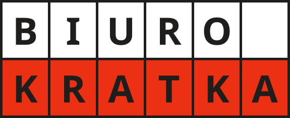

<p align="center">
  <picture>
    <source media="(prefers-color-scheme: dark)" srcset="logo-pack/ciemny/przezroczyste/svg/biurokratka-logo-ciemny.svg">
    
  </picture>
</p>

# Biurokratka — kompilator formularzy urzędowych

Biurokratka zamienia papierowy blankiet urzędowy w gotową do importu konfigurację formularza elektronicznego COI. Przyjmuje pliki PDF, DOC, DOCX, ODS, XLSX, JPG, JPEG i PNG, rozpoznaje pola oraz zależności, a następnie zwraca JSON zgodny z regułami technicznymi Generatora Formularzy.

To nie jest transkrypcja dokumentu. Biurokratka przeprojektowuje formularz: wydziela strony tematyczne, dobiera sekcje predefiniowane, walidatory i słowniki, usuwa elementy papierowe oraz wskazuje warunki widoczności. Końcowy JSON zawsze składa deterministyczny kompilator i sprawdza linter — model językowy może tworzyć tylko reprezentację pośrednią.

[Demo online](https://formularze.heckyeah.pl) · [Film — 87 s](https://formularze.heckyeah.pl/film.mp4) · [Prezentacja — 10 slajdów](submission/slides/Biurokratka-prezentacja.pdf) · [Wynikowe pliki JSON](outputs/README.md)

Projekt powstał na HackNation 2026 w ramach zadania Centralnego Ośrodka Informatyki „Cyfryzacja formularzy”.

## Co dostarcza projekt

- REST API przyjmujące pojedynczy blankiet i zwracające konfigurację JSON;
- obsługę wszystkich ośmiu wymaganych formatów wejściowych;
- parser PDF, Apache Tika dla dokumentów biurowych oraz OCR skanów i zdjęć;
- tryb reguł działający bez modelu i bez połączeń do usług zewnętrznych;
- opcjonalny model open-weight pod wymiennym endpointem zgodnym z OpenAI;
- dopasowanie słowników i danych inicjalnych oraz propozycje nowych słowników;
- zależności JSONata między polami, sekcjami i stronami;
- stanowisko urzędnika: kolejka plików, porównanie źródła z wynikiem, pewność rozpoznania, raport i eksport JSON;
- renderer e-formularza z walidacją między innymi PESEL, NIP i REGON;
- obrazy Docker utwardzone zgodnie z wymaganiami zadania.

W macierzy organizatora tryb reguł przetworzył 53 z 53 plików w ośmiu formatach z odpowiedzią HTTP 200 i bez błędów lintera. Metoda i pełne wyniki są w [macierzy formatów](research/08-macierz-formatow.md); ograniczenia jakości opisujemy [poniżej](#ograniczenia).

## Jak to działa

```text
blankiet
   │
   ├─ PDF ───────────────> pdfplumber + pypdfium2
   ├─ DOC/DOCX/ODS/XLSX ─> Apache Tika
   └─ JPG/JPEG/PNG ──────> RapidOCR + zapasowy Tesseract
                              │
                              ▼
                    dokument z układem stron
                              │
                  heurystyki + opcjonalny LLM
                              │
                              ▼
                    reprezentacja pośrednia (IR)
                              │
                 compiler ──> lint i auto-naprawa
                              │
                              ▼
                    JSON formularza COI + raport
```

Usługa działa w trzech kontenerach:

| Kontener | Rola | Dostęp |
|---|---|---|
| `web` | React, renderer i nginx proxy | `127.0.0.1:8080` |
| `api` | FastAPI, ingest, OCR, kompilator i linter | tylko sieć kontenerów |
| `tika` | odczyt plików biurowych | izolowana sieć wewnętrzna |

Szczegóły potoku, model danych i decyzje projektowe opisuje [ARCHITECTURE.md](ARCHITECTURE.md).

## Szybki start

Wymagane są Docker Engine z wtyczką Compose oraz co najmniej 4 GB wolnej pamięci. Konfiguracja była sprawdzana na Docker 26.1 i Compose 2.26.

Domyślnie nie potrzeba pliku `.env`: aplikacja uruchomi się w trybie reguł, bez modelu i bez kluczy API.

```sh
docker compose up -d --build --wait
docker compose ps
curl http://127.0.0.1:8080/health
```

Po starcie:

- stanowisko urzędnika: <http://127.0.0.1:8080>;
- podgląd dowolnego JSON-a: <http://127.0.0.1:8080/podglad>;
- Swagger UI: <http://127.0.0.1:8080/docs>;
- OpenAPI: <http://127.0.0.1:8080/openapi.json>.

Oczekiwana odpowiedź health checku w trybie reguł:

```json
{"status":"ok","llm_enabled":false}
```

Zatrzymanie stosu:

```sh
docker compose down
```

## Budowanie obrazów Docker

Wszystkie trzy obrazy:

```sh
docker compose build
```

Wybrany obraz i uruchomienie bez ponownego budowania:

```sh
docker compose build api
docker compose up -d --wait
```

Obrazy bazowe i zależności są przypięte do wersji; nie używamy tagu `latest`. Kontenery działają jako użytkownicy bez uprawnień, z systemem plików tylko do odczytu i katalogiem `/tmp` w `tmpfs`. Publikowany jest wyłącznie port nginx na interfejsie lokalnym.

## Konfiguracja

Ustawienia są pobierane ze zmiennych środowiskowych. Opcjonalny plik `.env` należy umieścić obok `compose.yaml`; wzór zawiera [.env.example](.env.example). Nie commituj `.env` ani sekretów.

| Zmienna | Domyślnie bez `.env` | Znaczenie |
|---|---:|---|
| `MAX_UPLOAD_MB` | `20` | maksymalny rozmiar jednego pliku |
| `MAX_PAGES` | `30` | maksymalna liczba stron dokumentu |
| `REQUEST_TIMEOUT_S` | `300` | limit czasu całego żądania |
| `MAX_ZIP_ENTRIES` | `1000` | limit wpisów w archiwach dokumentów biurowych |
| `MAX_UNZIPPED_MB` | `200` | limit danych po dekompresji |
| `MAX_IMAGE_PIXELS` | `120000000` | ochrona przed bombami obrazów |
| `AUTH_ENABLED` | `false` | włącza uwierzytelnianie JWT |
| `JWT_ALGORITHMS` | `RS256` | dozwolone algorytmy JWT, rozdzielone przecinkami |
| `JWT_PUBLIC_KEY` | puste | klucz publiczny dla `RS*`, `ES*`, `PS*` lub `EdDSA` |
| `JWT_SECRET` / `JWT_SECRET_FILE` | puste | sekret albo ścieżka do sekretu dla `HS*`; ustaw dokładnie jedno |
| `JWT_ISSUER`, `JWT_AUDIENCE` | puste | opcjonalna kontrola pól `iss` i `aud` |
| `LLM_ENABLED` | `false` | włącza etap modelu językowego |
| `LLM_BASE_URL` | `http://localhost:8080/v1` | endpoint zgodny z OpenAI |
| `LLM_MODEL` | `Qwen/Qwen3.5-9B` | identyfikator modelu |
| `LLM_API_KEY` | puste | klucz przekazywany w nagłówku Bearer |
| `LLM_ALLOW_REMOTE` | `false` | jawna zgoda na endpoint spoza sieci lokalnej |
| `LLM_TIMEOUT_S` | `120` | limit czasu wywołania modelu |
| `OCR_MIN_CONFIDENCE` | `0.8` | próg uruchomienia zapasowego OCR Tesseract |
| `TIKA_URL` | `http://tika:9998` | adres Tiki; w Compose ustawiany automatycznie |

Przy `AUTH_ENABLED=true` wybierz jedną rodzinę algorytmów. Nie wolno mieszać `HS*` z algorytmami klucza publicznego. Brak wymaganego klucza zatrzymuje aplikację podczas startu.

## REST API

API jest dostępne przez nginx pod `http://127.0.0.1:8080`.

| Metoda i ścieżka | Odpowiedź |
|---|---|
| `POST /api/v1/forms` | końcowy JSON formularza |
| `POST /api/v1/forms?details=true` | `{ "form": ..., "report": ... }` |
| `GET /health` | stan usługi i informacja, czy model jest włączony |

Plik należy przesłać jako `multipart/form-data` w polu `file`:

```sh
curl --fail-with-body \
  -F "file=@/sciezka/do/wniosku.pdf" \
  http://127.0.0.1:8080/api/v1/forms \
  --output formularz.json
```

Raport diagnostyczny zawiera tryb przetwarzania, model, czasy etapów, wynik lintera, źródła i pewność pól, dokument po ekstrakcji oraz propozycje nowych słowników:

```sh
curl --fail-with-body \
  -F "file=@/sciezka/do/wniosku.pdf" \
  "http://127.0.0.1:8080/api/v1/forms?details=true" \
  --output wynik-z-raportem.json
```

Jeżeli JWT jest włączony, dodaj `-H "Authorization: Bearer <token>"`.

### Walidacja wejścia

- rozszerzenie: `.pdf`, `.doc`, `.docx`, `.ods`, `.xlsx`, `.jpg`, `.jpeg`, `.jpe` lub `.png`;
- sygnatura zawartości musi odpowiadać rozszerzeniu;
- nazwa może mieć najwyżej 250 znaków i nie może zawierać `; : > < / \ | ' * % $`;
- rozmiar nie może przekroczyć `MAX_UPLOAD_MB`;
- plik istnieje tylko w pamięci lub `tmpfs` przez czas żądania; log zawiera wyłącznie SHA-256 i rozmiar.

### Kody odpowiedzi

| Kod | Znaczenie |
|---:|---|
| `200` | formularz wygenerowany; także po automatycznym przejściu z modelu na reguły |
| `400` | nieprawidłowa nazwa pliku albo uszkodzone żądanie |
| `401` | brak lub nieprawidłowy token JWT |
| `413` | przekroczony limit rozmiaru |
| `415` | nieobsługiwany typ albo treść niezgodna z rozszerzeniem |
| `429` | limit nginx: 10 przesłań na minutę z jednego adresu IP |
| `504` | przekroczony `REQUEST_TIMEOUT_S` |

Błędy mają typ `application/problem+json` zgodny z RFC 9457.

## Tryby analizy

### Reguły — domyślnie

`LLM_ENABLED=false`. Heurystyki wykrywają pola, a usługa nie łączy się z niczym poza własnymi kontenerami. Jest to najprostszy tryb do lokalnego uruchomienia i walidacji technicznej.

### Model open-weight przez endpoint zdalny

Konfiguracja demonstracyjna korzysta z Qwen3.5-9B na europejskim endpoincie EdenAI. Jest to świadomy wyjątek uzgodniony z mentorem COI: model ma otwarte wagi na licencji Apache-2.0 i może zostać uruchomiony na własnej infrastrukturze. Kod nie zależy od EdenAI.

```sh
cp .env.example .env
# uzupełnij LLM_API_KEY w .env
docker compose up -d --build --wait
```

Zdalny adres wymaga jednocześnie `LLM_ENABLED=true` i `LLM_ALLOW_REMOTE=true`. Awaria lub błędna odpowiedź modelu nie powoduje błędu 500 — potok automatycznie wraca do trybu reguł.

### Lokalny model

Ten sam klient współpracuje z `llama-server` z projektu llama.cpp:

```sh
llama-server -m Qwen3.5-9B-Q4_K_M.gguf --jinja --reasoning-budget 0 \
  -c 32768 --host 0.0.0.0 --port 8080
```

```dotenv
LLM_ENABLED=true
LLM_ALLOW_REMOTE=false
LLM_BASE_URL=http://host.docker.internal:8080/v1
LLM_MODEL=Qwen/Qwen3.5-9B
```

Wariant lokalny nie był testowany podczas hackathonu. Laptop demonstracyjny M1 Pro z 16 GB RAM uruchamiał `web`, `api` i `tika`, a model był wywoływany przez endpoint UE.

## Wyniki i koszt

| Pomiar | Wynik |
|---|---|
| Macierz wejść w trybie reguł | 53/53 pliki zakończone HTTP 200, 0 błędów lintera |
| PDF w trybie reguł | 0,05–2 s na formularz |
| OCR zdjęcia 16 stron | 15 s na M1 Pro, 21 s na serwerze 8-rdzeniowym |
| Model przez EdenAI | około 0,001 USD na formularz |
| Czas modelu dla zmierzonych formularzy | 6,5–45 s |

Wyniki zależą od długości i jakości blankietu. Surowe pomiary: [research/08-macierz-formatow.md](research/08-macierz-formatow.md), [research/10-pokrycie-referencji.md](research/10-pokrycie-referencji.md) i [outputs/README.md](outputs/README.md).

## Testy i jakość

API wymaga Python 3.14 i menedżera `uv`:

```sh
cd api
uv sync
uv run pytest
uv run ruff check .
uv run ruff format --check .
uv run mypy --strict src
```

Frontend wymaga Node.js oraz npm:

```sh
cd web
npm ci
npm run lint
npm test
npm run build
```

Kontrola licencji uruchamiana z katalogu głównego:

```sh
python3 devtools/check_licenses.py
```

Dozwolone są zależności open source bez copyleftu. Raport, w tym dwa jawne wyjątki przechodnie MPL-2.0, znajduje się w [research/09-licencje.md](research/09-licencje.md).

Wynikowe pliki dla formularzy konkursowych generuje działająca usługa; nie edytujemy ich ręcznie:

```sh
uv run --project api python devtools/generate_outputs.py \
  --api http://127.0.0.1:8080
```

## Struktura repozytorium

| Ścieżka | Zawartość |
|---|---|
| [`api/`](api/) | FastAPI, ingest, OCR, IR, kompilator, linter i testy |
| [`web/`](web/) | stanowisko urzędnika i renderer e-formularza |
| [`tika/`](tika/) | obraz sidecara Apache Tika |
| [`outputs/`](outputs/README.md) | JSON-y wygenerowane dla formularzy konkursowych |
| [`submission/`](submission/) | opis zgłoszenia, prezentacja, film i raport zgodności |
| [`research/`](research/) | pomiary, porównania modeli, licencje i decyzje badawcze |
| [`Docs/`](Docs/) | niezmieniane materiały organizatora |
| [`ARCHITECTURE.md`](ARCHITECTURE.md) | architektura, kontrakt JSON i decyzje techniczne |
| [`DESIGN.md`](DESIGN.md) | system wizualny i wymagania dostępności |

## Ograniczenia

- OCR skanów i zdjęć daje mniej pewne wyniki niż tekstowe PDF-y i dokumenty biurowe.
- Tryb reguł gwarantuje działanie bez modelu, ale słabiej przeprojektowuje i nazywa pola merytoryczne.
- Zdalny endpoint modelu nie gwarantuje identycznej odpowiedzi mimo temperatury `0` i stałego ziarna.
- Lokalny `llama-server` jest konfiguracją docelową, lecz nie został przetestowany podczas hackathonu.
- Import do produkcyjnego Generatora Formularzy wymaga końcowego testu integracyjnego po stronie COI.

## Materiały konkursowe

- [szczegółowy opis zgłoszenia](submission/OPIS-ZGLOSZENIA.md);
- [prezentacja PDF — 10 slajdów](submission/slides/Biurokratka-prezentacja.pdf);
- [film demonstracyjny — 87 s](https://formularze.heckyeah.pl/film.mp4);
- [wynikowe JSON-y](outputs/README.md);
- [raport zgodności z wymaganiami COI](submission/RAPORT-ZGODNOSCI.md).

Zespół: Adam (Adimac93) — backend, potok, model i linter; Stanisław Synowiec — frontend, renderer i dostępność; fidok15 — research OCR.
